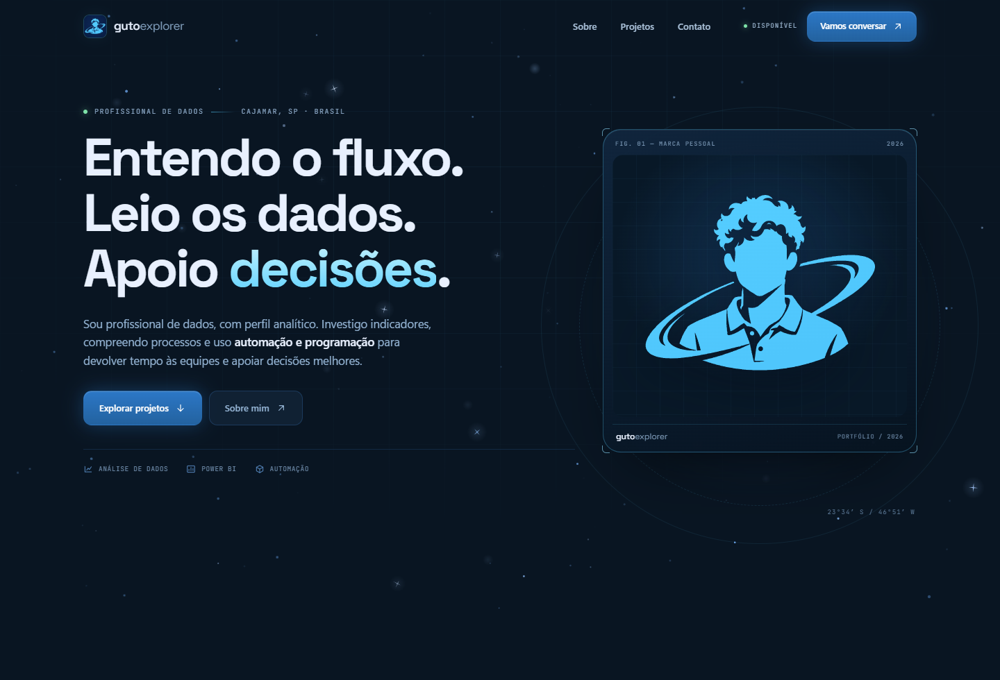
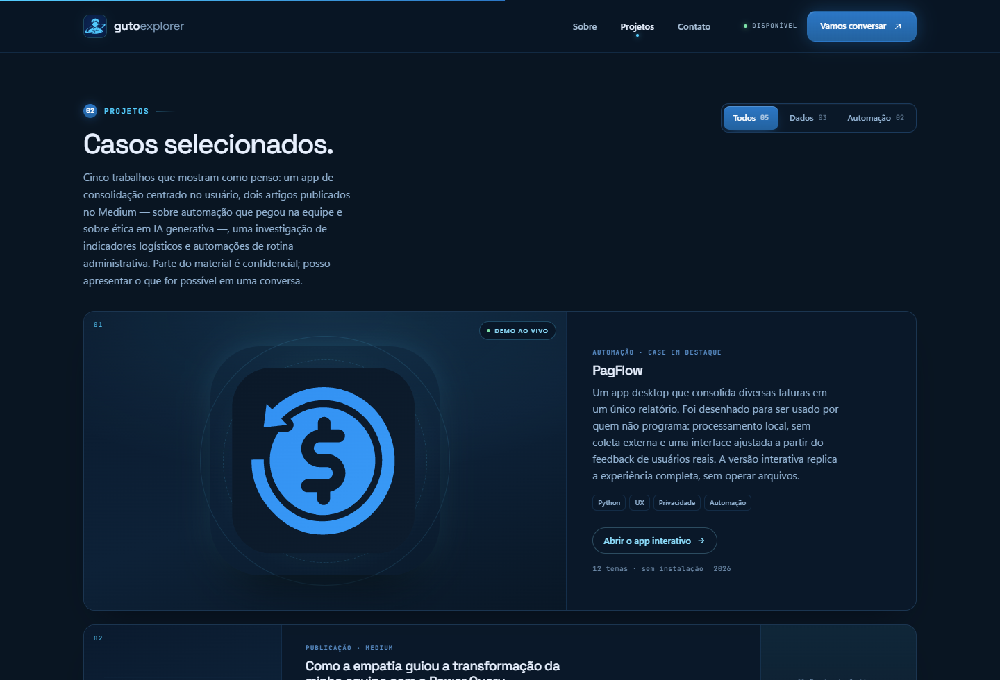
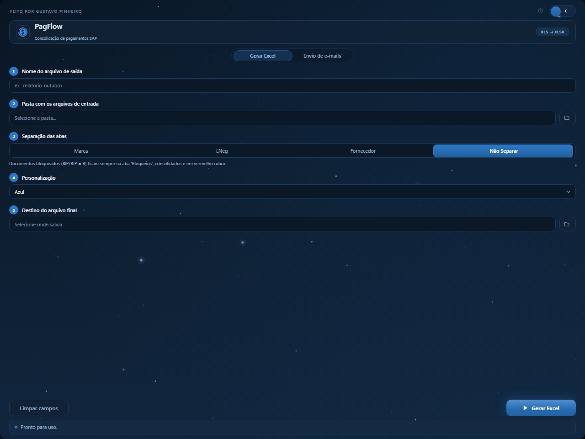
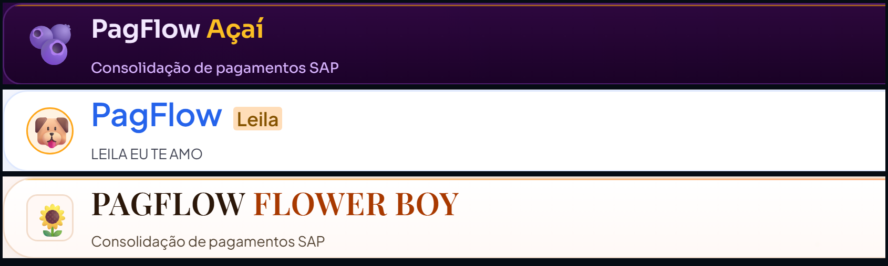

# gutoexplorer — portfólio

Site estático de uma página para o **gutoexplorer**, o portfólio de **Gustavo Pinheiro**, profissional de dados com foco em análise, melhoria de processos e apoio à decisão. A página apresenta a trajetória, cinco trabalhos — três casos e dois artigos publicados no Medium — e os canais de contato. O primeiro projeto em destaque é o **PagFlow**, com um estudo de caso interativo em canvas. O tema é o **Céu Estrelado** descrito em `fundo-estrelado-escuro.md`: gradiente noturno, estrelas em canvas, um azul de ação (`--accent`) e um azul celeste de marca (`--celeste`).

O conteúdo segue o documento privado de contextualização de 13/11/2026. Esse documento não deve ser publicado junto do site: ele reúne dados pessoais e informações corporativas que não pertencem a uma página pública.



## Versão React (atual)

O site foi migrado para **Next.js 16 + React 19 + TypeScript**, com export estático, e vive em `web/`. A versão descrita no restante deste README é a original em HTML/CSS, mantida como referência de paridade visual.

```bash
cd web
npm install
npm run dev      # http://localhost:3000
npm run build    # gera web/out (HTML por rota + sitemap + OG image)
```

O que mudou: conteúdo tipado em `content/`, interações em componentes React, fontes WOFF2 com subset (432 KB → 86 KB), SVGs otimizados, metadados/JSON-LD/sitemap por rota, Lenis + GSAP sob demanda e axe no CI. Os CTAs usam o **Magnet** e o CTA do header usa o **StarBorder** do React Bits (código-fonte local, sem dependência nova), e o céu ganhou uma **estrela cadente** rara — a primeira depois de 8–13 s, as seguintes a cada 34–76 s. A paridade visual foi medida em 0,019% (1440), 0,032% (834) e 0,065% (390) de pixels diferentes.

Detalhes: [`web/README.md`](web/README.md) · estudo: [`docs/react/PLANO-REACT.md`](docs/react/PLANO-REACT.md) · resultado: [`docs/react/RESULTADO.md`](docs/react/RESULTADO.md).

## Como abrir (versão original)

```bash
cd portifolio
python -m http.server 4321
# depois abra http://127.0.0.1:4321/
```

Também funciona abrindo `index.html` direto no navegador (o site não usa módulos ES nem servidor). O servidor é recomendado para testar navegação e cache como em produção.

## Estrutura

```
index.html                    página única (hero, sobre, projetos, contato, rodapé)
pagflow/                      réplica interativa do app PagFlow (página própria)
  index.html                  janela 1280×960 + gaveta com os 12 temas e a demo
  app.css                     layout pixel a pixel, componentes e diálogos
  app.js                      tokens dos temas, fundo em canvas, estrelas e interações
  assets/fonts/               as TTFs OFL usadas pelos temas (Anton, Chivo, Outfit…)
  assets/img/                 artes de capa e as fotos da Leila
  assets/brand/               marcas do app (claro e escuro) em PNG
assets/
  css/tokens.css              tokens do tema e as fontes locais (Space Grotesk, JetBrains Mono)
  css/site.css                layout, componentes, direção A e responsivo
  fonts/                      TTF OFL de Space Grotesk e JetBrains Mono (sem CDN)
  js/stars.js                 céu estrelado em canvas + constelação que segue o ponteiro
  js/site.js                  menu, scroll spy, reveal, filtro, ímã, tilt e spotlight
  brand/guto-logo.svg         marca com fundo navy (ícone/avatar/favicon)
  brand/guto-mark.svg         marca transparente (cabeçalho e hero)
  brand/favicon.svg           favicon
  projects/pagflow-icon.svg   ícone oficial do app (vetor) usado no cartão em destaque
docs/                         capturas de referência do site
designs/guto-design-system/   design system editável (tokens, capa e marca)
designs/pagflow-case/         canvas do case PagFlow (macro, micro, temas e app)
designs/portfolio-direcoes/   canvas com as três direções (A implementada; B e C alternativas)
tools/shot.py                 captura as telas da réplica (Selenium + Edge headless)
tools/site_shots.py           captura o portfólio em desktop, tablet e mobile
tools/render_direcoes.py      renderiza as direções em 1440×1024 fora do canvas
tools/type_audit.py           auditoria tipográfica: emoji, nomes e texto duplamente codificado
tools/serve_out.py            serve web/out (e simula a subpasta do Pages com --base)
tools/qa_next.py              QA do export React: filtro, menu, âncoras, aviso mobile, metas
tools/a11y_next.py            axe-core na home, no PagFlow e no diálogo de mobile
tools/vitals_next.py          FCP, LCP, CLS, TBT e peso transferido do export
tools/mobile_audit.py         auditoria mobile: rolagem horizontal, alvos < 44 px e capturas
.github/workflows/pages.yml   prévia do site React no GitHub Pages
```

## O que editar primeiro

1. **Textos do hero e do Sobre** — `index.html`, seção `#inicio` e `#sobre`. O nome de marca é `gutoexplorer`; o retrato é a logo. A headline do hero é dividida em três `.line` para a entrada em máscara; o retrato vive em `.hero__tilt > .portrait` (tilt, ticks, barra FIG. 01 e legenda). Não troque a estrutura das linhas sem revisar a animação em `site.css`.
2. **Contato** — o e-mail profissional `gustavo.pinheirodev997@gmail.com` aparece no menu mobile, no botão de contato e no rodapé. LinkedIn (`gustavo-pinheiro-75278b2a7`) e Medium (`@glutox`) são os canais principais.
3. **Casos** — o PagFlow é o cartão vitrine (`article.project--wide.project--showcase`): duas colunas, com o ícone oficial (`assets/projects/pagflow-icon.svg`) dentro de `.project__icon-wrap`, um selo “Demo ao vivo” e o CTA logo abaixo das tags, ainda na coluna de texto, seguido da linha de meta (temas · ano). O segundo é o artigo fixado no Medium (`article.project--reading`, formato de leitura em linha inteira: arte em `.project__rail`, texto e botão “Ler no Medium” em `.project__side`). Os outros dois são a revisão de metas de entrega e as automações administrativas. Nome, descrição, tags, ano, categoria e o texto do CTA ficam no HTML; os números do filtro (`Todos 05`, `Dados 03`, `Automação 02`) e o `data-category` precisam ser atualizados juntos. O filtro fica no topo direito do bloco em telas largas, abaixo do texto até 1080px e em três colunas iguais no mobile.
4. **Links** — o “Abrir o app interativo” é o único link do cartão e só responde na própria área do botão (nada de alvo esticado pelo cartão), apontando para `pagflow/index.html`. O “Ler no Medium” usa o mesmo recurso esticado de antes (`.project__read::after`, URL do artigo em `medium.com/@glutox/…`). Não coloque outro link ou botão dentro desses cartões, e não aplique `transform` no link: um ancestral transformado encolheria a área clicável para o botão. O case em canvas continua disponível no editor local. O GitHub (`ItsGlutos`) fica no rodapé.
5. **Ano do rodapé** — é automático (`data-year`); o “portfólio / 2026” do retrato é fixo.

**Movimento do cartão em destaque.** O ícone tem vida própria: no repouso, ele flutua devagar, os aros giram e o selo “Demo ao vivo” pulsa. No hover do cartão, ele sobe, a borda e os aros acendem e o ícone pausa a flutuação para se inclinar 4,5° para a esquerda a partir da base — pivô em 68% da altura, com o deslocamento lateral compensado para o centro não sair do eixo, e uma curva com leve ultrapassagem para o gesto ter peso e se acomodar. Sombra e brilho acompanham a peça, como um objeto único. O CTA é um link discreto, com interação restrita ao próprio botão. As amplitudes ficam em `.project--showcase:hover .project__icon` e no aro, em `site.css`. Além desse gesto, todos os cartões recebem o spotlight da direção A (`.project::after`, alimentado por `--mx`/`--my`): uma luz suave que acompanha o ponteiro e não interfere nos cliques. Com `prefers-reduced-motion: reduce` (Windows: Configurações › Acessibilidade › Efeitos visuais desligados), os laços automáticos param e o ímã/tilt desligam; a inclinação do ícone continua animada em 460 ms.



## Posicionamento e conteúdo

- Gustavo é **profissional de dados com perfil analítico**, não desenvolvedor de software por profissão. Programação, automação e BI são instrumentos a serviço da análise e da melhoria de processos.
- O foco editorial é entender o problema, ouvir quem executa a rotina, investigar indicadores e apoiar decisões. Evite adjetivos genéricos como “inovador”, “visionário” ou “especialista”.
- **Não inventar métricas.** Não há números confirmados de economia de tempo, redução de custos, produtividade ou adoção. Resultados devem ser descritos como objetivos ou mudanças observadas, não como ganhos mensurados.
- **Separar contribuição individual de trabalho coletivo.** No caso das metas de entrega, o estudo técnico e a validação foram conduzidos pelo Planejamento de Transporte; Gustavo identificou o problema, ouviu as transportadoras e encaminhou a investigação.
- **Projetos corporativos são confidenciais.** Não publicar código, dados, capturas ou detalhes internos sem autorização. Use versões anonimizadas ou dados fictícios.
- **PagFlow:** o relato é de processamento local, sem coleta externa ou transmissão de dados da empresa. Isso descreve a arquitetura declarada; não é certificação jurídica, auditoria de segurança ou garantia de conformidade integral com a LGPD.
- **Artigo no Medium:** o cartão resume o texto fixado no perfil (`@glutox`). O relato é de primeira pessoa, e os números citados nele (três horas por dia de ETL manual → 30 a 40 minutos) são a conta do autor, não uma métrica auditada. A empresa não é nomeada no artigo — ele diz apenas “a maior distribuidora de medicamentos do país”; mantenha assim no site.
- **Trajetória:** Novitá Restaurantes (2024), SC Distribuição (2024–2026) e atuação atual em Qualidade. O título formal, a empresa vinculada à função em Qualidade e a data de início não foram confirmados; não inferir esses campos em currículos ou textos públicos.
- **Idiomas e formação:** Tecnólogo em Ciência de Dados pela UNICID, em andamento; Português nativo, Inglês intermediário e Mandarim iniciante.

## Case PagFlow

O PagFlow é um app desktop em PyQt6 que consolida extratos de pagamento do SAP em um único `.xlsx`. Ele aparece em dois lugares:

**A réplica interativa** — `pagflow/index.html`, aberta pelo cartão em destaque. É a interface inteira em HTML, CSS e canvas, no tamanho real da janela (1280 × 960, escalada para caber), com:

- as duas telas (**Gerar Excel** e **Envio de e-mails**), com a dissolução de uma na outra;
- os **doze temas** (Escuro, Claro, Graduation, Ozzy, Lana Del Rey, Açaí, Vaporwave, Alien, Wolverine, Flower Boy, Natal e Leila), cada um com suas fontes, motivos, padrão de fundo pintado à mão, animação de estrelas/neve e bordas próprias;
- as **Configurações** com as cinco abas, a grade de temas e o desbloqueio por código;
- a **revisão de envio** com tabela, checkboxes e totais, e as caixas de mensagem do app;
- os estados da barra de status (pronto, aviso, erro, ocupado) e as animações de tema, aba e segmentado.

Nada operacional funciona: nenhum arquivo é lido, gerado ou enviado. Os botões de pasta preenchem caminhos de exemplo, “Gerar Excel” simula o processamento e “Preparar envios” abre a revisão com dados de demonstração. O botão **12 temas · demo**, no alto da página, abre a gaveta com a galeria de temas e os atalhos de demonstração (preencher exemplo, configurações, revisão de envio, códigos secretos). O par corporativo **GrupoSC** ficou de fora, como no case.



**Tipografia.** Duas armadilhas apareceram na réplica e ficaram resolvidas de forma sistemática:

- **Emoji do logo.** No app, `draw_logo_emoji()` mede a tinta real do glifo, escala até 90% do miolo do tile e centraliza pela tinta, não pela linha de base. A réplica agora faz o mesmo num canvas de 30px (alvo de 27px sem tile e 21,6px com tile), então 🐻, 🦇, 🍒, 🫐, 🌴, 👽, 🐺, 🌻, 🎄 e 🐶 saem do mesmo tamanho ótico e centrados. Antes, texto solto deixava o avanço do glifo estourar o tile e cada emoji caía num lugar diferente.
- **Nome + sufixo da marca.** O app monta o rótulo em rich text: `rótulo + espaço + sufixo` (dois `&nbsp;` quando o sufixo tem corpo menor, e mais um `&nbsp;` de cada lado quando ele tem marca-texto). A réplica usava `margin-left`, o que dobrava o vão e, como os dois eram itens de flex, o sufixo de corpo menor flutuava acima da linha de base. Agora é uma linha inline única: sufixo assentado na mesma linha de base, vão igual ao do app e texto copiável (“PagFlow Graduation”, com espaço).
- **Texto duplamente codificado.** O `app.js` tinha 109 linhas em UTF-8 lido como cp1252 — era isso que fazia “Açaí” virar `Açaí` e o emoji virar `ðŸ«`. O arquivo foi reprocessado byte a byte e hoje as descrições, o subtítulo da Leila, a revisão e as mensagens aparecem com os acentos certos. `tools/type_audit.py` falha se isso voltar a acontecer.



**O canvas do case** vive em `designs/pagflow-case/`:

- **Main** — visão geral, com a tela oficial e os doze temas.
- **Macro** — a leitura para gestores: o problema, os três passos e o que muda, sem jargão.
- **Micro** — a leitura para TI: pipeline, `detectar_relat()`, `parse_sap_valor()`, bibliotecas, tipos de documento, escrita atômica e contrato de dados.
- **Temas** — a galeria dos doze temas com capturas em tamanho real.
- **App** — a interface recriada em HTML, interativa e sem backend: a trilha troca os temas, as abas alternam as duas telas e os botões de ação respondem com uma mensagem de simulação.

A recriação usa os mesmos tokens de cor, fontes e motivos do aplicativo — os valores estão em `pagflow/app.js` (transcritos de `main.py` e `temas_extra.py`). Como o app é privado, o código-fonte do PyQt não está neste repositório.

Para abrir o canvas: peça ao agente para rodar o editor do `designs/pagflow-case/` (o endereço local é informado no chat).

## Design system

Os valores visuais vivem em `assets/css/tokens.css` e são a fonte da verdade do site. Para editar tokens com uma interface (cores, tipografia, espaçamento, raios e sombras), abra o design system em `designs/guto-design-system/` pelo editor local do Claude Design System (`artifact.mjs open`). Ele inclui a capa, o brand book, os tokens e os dois SVGs da marca.

O design system foi validado com `problems: 0`. Se você mudar um token lá, copie o mesmo valor para `assets/css/tokens.css` — são dois arquivos por enquanto.

## Direção A — implementada

O site passou a usar a direção **A · Órbita viva**. O céu estrelado continua sendo a identidade: o canvas de estrelas não saiu do lugar e ganhou uma constelação de proximidade — o ponteiro vira mais uma estrela e liga as estrelas ao alcance, sem substituir o céu por um fundo genérico.

- **Tipografia** — Space Grotesk nos títulos (local, em `assets/fonts`), Segoe UI no texto e JetBrains Mono nos rótulos. O site continua offline.
- **Hero** — headline em três linhas com entrada em máscara, retrato em janela orbital 452 × 466 com ticks, barra FIG. 01 e coordenadas. O grid usa 1200px de conteúdo e o retrato alinha ao topo da headline.
- **Interações** — ímã nos CTAs, tilt e brilho no retrato, spotlight nos cartões e constelação no ponteiro. O ímã, o tilt e a entrada da headline desligam com `prefers-reduced-motion: reduce`; a luz dos cartões e a constelação continuam, porque só respondem ao ponteiro.
- **Contato** — em telas largas, as três ações ficam na coluna direita do painel, liberando o texto à esquerda; abaixo de 1040px volta ao fluxo vertical.
- **Céu** — a grade de 80px é só um instrumento discreto sobre o herói; as estrelas continuam sendo o fundo em todas as seções.

O canvas `designs/portfolio-direcoes/` mantém as três pranchas de 1440 × 1024. A prancha A é a referência do que está no site; B · Instrumento e C · Aurora continuam como alternativas, cada uma com **Play** no editor.

Prints: `docs/preview-desktop.png`, `docs/preview-projetos.png`, `docs/direcoes-comparativo.png`, `docs/direcao-a-orbita.png`, `docs/direcao-b-instrumento.png` e `docs/direcao-c-aurora.png`. Para regerar o site: `python tools/site_shots.py`. Para as direções fora do canvas: `python tools/render_direcoes.py`.

### Ajustes de espaçamento já aplicados

- O filtro de projetos deixou de flutuar no meio do parágrafo: em telas largas ele fica no topo direito, alinhado ao rótulo da seção; até 1080px desce para baixo do texto.
- No mobile o filtro não quebra mais em 2 + 1: são três colunas iguais, sem o botão órfão centralizado na segunda linha.
- O atalho “explorar” saiu do hero. A leitura segue no fluxo normal e no menu; o rodapé mantém “Voltar ao topo”.
- Os contadores do filtro subiram de 9px para 10px, para não sumirem no fundo.
- O retrato agora alinha ao topo da headline, e o painel de contato deixou de ter a metade direita vazia.

## Acessibilidade e desempenho

- Contraste de texto conferido contra os fundos do tema; foco visível em todos os controles.
- `prefers-reduced-motion`: conteúdo sem animação de entrada, ímã, tilt e giro dos aros desligados; as estrelas continuam o movimento perpétuo do tema.
- Alvos de toque de 44px nos controles principais; menu mobile fecha com `Esc` e prende o foco no painel.
- Céu com semente fixa (`20261104`), 25 fps, pausado com a aba oculta, sem dependências externas.
- Space Grotesk e JetBrains Mono são servidas de `assets/fonts` (TTF OFL), e o texto usa Segoe UI. Nada de CDN: o site carrega offline.

Na réplica do PagFlow, o mesmo cuidado: `Esc` fecha os diálogos, o `Tab` circula dentro do modal e devolve o foco ao botão que o abriu, a barra de status e a seleção da revisão são regiões `aria-live`, as abas respondem às setas do teclado e o “reduzir animações” da aba Geral congela estrelas e flocos.

Teste em 360, 390, 768, 1024 e 1440px, com teclado (Tab/Shift+Tab) e com “reduzir movimento” ativado no sistema.

## Publicar

O site atual é o React em `web/` (export estático). Há dois destinos com papéis
diferentes — o passo a passo completo está em [`web/DEPLOY.md`](web/DEPLOY.md):

- **GitHub Pages — prévia para visualização.** O workflow `.github/workflows/pages.yml`
  compila com `npm run build:pages` (basePath `/portifolio`, `noindex`, `.nojekyll`)
  e publica em `https://itsglutos.github.io/portifolio/`. Antes, ligue em
  **Settings → Pages → Source: GitHub Actions**.
- **Vercel — site de verdade.** Importe o repositório com **Root Directory = `web`**;
  o Next.js é detectado e o `web/vercel.json` cuida de headers, cache e
  `trailingSlash`. Com domínio próprio, defina `NEXT_PUBLIC_SITE_URL` e refaça o
  deploy. Import de produção sai indexável; previews da Vercel saem `noindex`.

A versão original em HTML (`index.html` + `assets/` + `pagflow/`) continua
publicável na raiz do repositório, sem build, como referência de paridade. O link
do cartão do PagFlow é relativo (`pagflow/`), então funciona tanto na raiz quanto
na subpasta do Pages.

## Aviso de mobile no PagFlow

A réplica do PagFlow é uma janela de desktop (1280 × 960). Em tela pequena ela
fica com ~27% do tamanho original: texto ilegível e controles fora de alcance.
Por isso o site avisa em dois momentos: uma nota no cartão em destaque (até
900 px) e, ao tocar em “Abrir o app interativo”, um diálogo nativo que explica o
limite e deixa continuar. A própria réplica (`pagflow/index.html`) também mostra
um aviso destacado no topo em telas de até 900 px.

## Manutenção da réplica

As capturas de referência saem do próprio site, com Edge headless:

```bash
python tools/shot.py            # as 12 telas + diálogos em tools/shots/
python tools/qa.py              # roteiro de cliques (toggle, código, revisão, foco)
python tools/fit.py             # confere o enquadramento em vários tamanhos de tela
python tools/type_audit.py      # tipografia: emoji no alvo, nomes cortados, mojibake
python tools/site_shots.py      # portfólio em 1440, 834 e 390 + seções
python tools/site_interactions.py  # ímã, tilt, constelação e spotlight
```

`type_audit.py` percorre os doze temas com a janela em escala 1 e sai com código 1 quando encontra texto duplamente codificado, emoji fora do alvo do PyQt, sufixo fora da linha de base, nome truncado na grade ou qualquer texto cortado sem reticências. Ele é o teste de regressão da parte tipográfica — rode antes de regerar as capturas.

As capturas são a fonte das imagens do canvas do case (`Temas.dc.html`), então depois de mexer na réplica vale regerá-las e subir de novo com `artifact.mjs upload`.

## Notas

- `gutoexplorer.png` e `gutoexplorer.svg` na raiz são os arquivos originais da marca. As cópias em `assets/brand/` têm o `aria-label` corrigido e não são editadas pelo site.
- `fundo-estrelado-escuro.md` é o guia de design que originou o tema; o `tokens.css` e o design system seguem os valores dele.
- O canvas de estrelas não é uma imagem: ele se redimensiona com a janela e adapta a densidade (~1 estrela a cada 4.500px², teto de 140).
