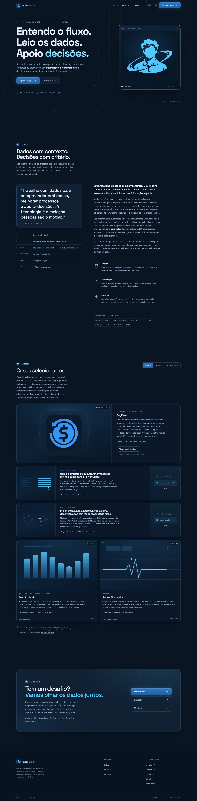

# gutoexplorer — portfólio

Site do **gutoexplorer**, o portfólio de **Gustavo Pinheiro**, profissional de dados com foco em análise, melhoria de processos e apoio à decisão. A página apresenta a trajetória, cinco trabalhos — três casos e dois artigos publicados no Medium — e os canais de contato. O primeiro projeto em destaque é o **PagFlow**, com um estudo de caso interativo.

O tema é o **Céu Estrelado**: gradiente noturno, estrelas em canvas, um azul de ação (`--accent`) e um azul celeste de marca (`--celeste`).

**Stack:** Next.js 16 (App Router) · React 19 · TypeScript · export estático. Todo o código do site vive em [`web/`](web/README.md).



## Rodar

```bash
cd web
npm install
npm run dev      # http://localhost:3000
```

```bash
npm run build      # export estático em web/out
npm run preview    # serve web/out em http://localhost:4173
npm run typecheck  # tsc --noEmit
npm run lint       # oxlint
```

O site não abre por duplo clique (`file://`): há build, rotas com HTML próprio e hidratação.

## Estrutura

```
web/                          o site (Next.js + React + TypeScript)
  app/                        layout, metadata/JSON-LD, home, 404, sitemap, robots, manifest, OG image
  app/globals.css             tokens e CSS do site
  components/                 layout, seções, projetos, UI, céu, movimento e React Bits
  content/                    profile.ts · projects.ts (fonte única do conteúdo)
  lib/                        starfield, hooks, asset (basePath), URL do site
  public/assets/              marca e ícone do PagFlow
  public/pagflow/             réplica interativa do app PagFlow (servida em /pagflow/)
  scripts/build-pages.mjs     build da prévia do GitHub Pages
  DEPLOY.md                   passo a passo de GitHub Pages e Vercel
docs/react/                   estudo da migração, resultado e prévias
tools/
  serve_out.py                serve web/out (simula a subpasta do Pages com --base)
  qa_next.py                  QA do export: filtro, menu, âncoras, aviso mobile, metas
  a11y_next.py                axe-core na home, no PagFlow e no diálogo de mobile
  vitals_next.py              FCP, LCP, CLS, TBT e peso transferido
  mobile_audit.py             auditoria mobile: rolagem horizontal, alvos < 44 px e capturas
.github/workflows/pages.yml   prévia do site no GitHub Pages
```

## O que editar

1. **Conteúdo** — `web/content/profile.ts` (nome, contato, fatos, ferramentas) e `web/content/projects.ts` (projetos, tags, categorias, anos e o aviso do PagFlow). Os contadores do filtro são derivados do array, não digitados à mão.
2. **Textos das seções** — `web/components/sections/` (Hero, About, Projects, Contact). O nome de marca é `gutoexplorer`; o retrato é a logo.
3. **Visual** — tokens e CSS em `web/app/globals.css`. As fontes (Space Grotesk e JetBrains Mono, WOFF2 com subset) ficam em `web/lib/fonts/`.
4. **Céu e movimento** — `web/lib/starfield.ts` (semente fixa, 25 fps, constelação, estrela cadente) e `web/components/motion/` (Lenis + GSAP sob demanda).
5. **Réplica do PagFlow** — `web/public/pagflow/` é copiada como está; o site apenas linka para ela.

## Posicionamento e conteúdo

- Gustavo é **profissional de dados com perfil analítico**, não desenvolvedor de software por profissão. Programação, automação e BI são instrumentos a serviço da análise e da melhoria de processos.
- O foco editorial é entender o problema, ouvir quem executa a rotina, investigar indicadores e apoiar decisões. Evite adjetivos genéricos como “inovador”, “visionário” ou “especialista”.
- **Não inventar métricas.** Não há números confirmados de economia de tempo, redução de custos, produtividade ou adoção. Resultados devem ser descritos como objetivos ou mudanças observadas, não como ganhos mensurados.
- **Separar contribuição individual de trabalho coletivo.** No caso das metas de entrega, o estudo técnico e a validação foram conduzidos pelo Planejamento de Transporte; Gustavo identificou o problema, ouviu as transportadoras e encaminhou a investigação.
- **Projetos corporativos são confidenciais.** Não publicar código, dados, capturas ou detalhes internos sem autorização. Use versões anonimizadas ou dados fictícios.
- **PagFlow:** o relato é de processamento local, sem coleta externa ou transmissão de dados da empresa. Isso descreve a arquitetura declarada; não é certificação jurídica, auditoria de segurança ou garantia de conformidade integral com a LGPD.
- **Artigo no Medium:** o cartão resume o texto fixado no perfil (`@glutox`). O relato é de primeira pessoa, e os números citados nele (três horas por dia de ETL manual → 30 a 40 minutos) são a conta do autor, não uma métrica auditada. A empresa não é nomeada no artigo — ele diz apenas “a maior distribuidora de medicamentos do país”; mantenha assim no site.
- **Trajetória:** Novitá Restaurantes (2024), SC Distribuição (2024–2026) e atuação atual em Qualidade. O título formal, a empresa vinculada à função em Qualidade e a data de início não foram confirmados; não inferir esses campos em currículos ou textos públicos.
- **Idiomas e formação:** Tecnólogo em Ciência de Dados pela UNICID, em andamento; Português nativo, Inglês intermediário e Mandarim iniciante.

## Case PagFlow

O PagFlow é um app desktop em PyQt6 que consolida extratos de pagamento do SAP em um único `.xlsx`. No site ele aparece em dois lugares: no cartão em destaque da home e na réplica interativa em `/pagflow/`.

A réplica é a interface inteira em HTML, CSS e canvas, no tamanho real da janela (1280 × 960, escalada para caber), com as duas telas (**Gerar Excel** e **Envio de e-mails**), os **doze temas** (Escuro, Claro, Graduation, Ozzy, Lana Del Rey, Açaí, Vaporwave, Alien, Wolverine, Flower Boy, Natal e Leila), as **Configurações** com cinco abas e desbloqueio por código, a **revisão de envio** e as caixas de mensagem do app.

Nada operacional funciona: nenhum arquivo é lido, gerado ou enviado. Os botões de pasta preenchem caminhos de exemplo, “Gerar Excel” simula o processamento e “Preparar envios” abre a revisão com dados de demonstração. O par corporativo **GrupoSC** ficou de fora.

Como o app é privado, o código-fonte do PyQt não está neste repositório.

### Aviso de mobile

A réplica é uma janela de desktop (1280 × 960). Em tela pequena ela cai para ~27% do tamanho original: texto ilegível e controles fora de alcance. Por isso o site avisa em dois momentos: uma nota no cartão em destaque (até 900 px) e, ao tocar em “Abrir o app interativo”, um `<dialog>` nativo que explica o limite e deixa continuar. A própria réplica também mostra um aviso no topo em telas de até 900 px.

## Acessibilidade e desempenho

- Contraste de texto conferido contra os fundos do tema; foco visível em todos os controles.
- `prefers-reduced-motion`: conteúdo sem animação de entrada, ímã, tilt, giro dos aros e estrela cadente desligados; as estrelas continuam o movimento perpétuo do tema.
- Alvos de toque de 44 px; o menu mobile fecha com `Esc`, prende o foco no painel e devolve a rolagem exata no iOS.
- Céu com semente fixa (`20261104`), 25 fps, pausado com a aba oculta, sem dependências externas.
- Lenis e GSAP entram por `import()` dinâmico e não rodam com reduced motion nem em telas de toque.
- Resultado medido: axe sem violação grave/crítica, LCP 580 ms (desktop) / 420 ms (mobile) em localhost, CLS ≈ 0.

## Testes

Com o export servido (`python tools/serve_out.py 4300`):

```bash
python tools/qa_next.py      # filtro, contagens, menu, Esc/foco/inert, âncoras, reduced motion, metas
python tools/a11y_next.py    # axe-core (WCAG 2.1 AA + best practices) na home e no PagFlow
python tools/vitals_next.py  # FCP, LCP, CLS, TBT e peso transferido
python tools/mobile_audit.py --sections  # rolagem horizontal, alvos < 44 px e capturas
```

## Publicar

Há dois destinos, com papéis diferentes — o passo a passo completo está em [`web/DEPLOY.md`](web/DEPLOY.md):

- **GitHub Pages — prévia para visualização.** O workflow `.github/workflows/pages.yml` compila com `npm run build:pages` (basePath `/portifolio`, `noindex`, `.nojekyll`) e publica em <https://itsglutos.github.io/portifolio/>. Em **Settings → Pages → Source**, use **GitHub Actions**.
- **Vercel — site de verdade.** Importe o repositório com **Root Directory = `web`**; o Next.js é detectado e o `web/vercel.json` cuida de headers, cache e `trailingSlash`. Com domínio próprio, defina `NEXT_PUBLIC_SITE_URL` e refaça o deploy. Import de produção sai indexável; previews da Vercel saem `noindex`.

## Notas

- O céu não é uma imagem: ele se redimensiona com a janela e adapta a densidade (~1 estrela a cada 4.500 px², teto de 140).
- A estrela cadente é rara de propósito: a primeira passa depois de 8–13 s, as seguintes a cada 34–76 s (18% de chance de uma segunda logo atrás). As constantes ficam em `web/lib/starfield.ts`.
- Estudo da migração: [`docs/react/PLANO-REACT.md`](docs/react/PLANO-REACT.md) · resultado: [`docs/react/RESULTADO.md`](docs/react/RESULTADO.md).
